# TriageGuard: Clinical Decision Support System for Emergency Triage

> **Live, fully functional clinical decision support system for emergency triage with conformal prediction, monotonic LightGBM, multilingual NLP, and deterministic safety rules.**

[](https://www.python.org/)
[](https://opensource.org/licenses/MIT)
[]()
[-success.svg)]()
[]()

[](https://web-production-bb683.up.railway.app)
[](https://web-production-bb683.up.railway.app/docs)

> **AI Frontier Challenge 2026**  
> **GITAM University, Visakhapatnam**  
> 
> ### **Team — Ronin Labs**
> **Anudeep Gedela R S** · **Anga Yashwanth** · **Dileep Kumar Nagothi** · **Pavan Deepak Seeramreddi**

---

## 🌐 Live Interactive Deployment & ML Transparency

> 🚀 **Live Production Clinical Console:** [https://web-production-bb683.up.railway.app](https://web-production-bb683.up.railway.app)  
> 📖 **Interactive Swagger / OpenAPI Explorer:** [https://web-production-bb683.up.railway.app/docs](https://web-production-bb683.up.railway.app/docs)  
> 🩺 **Live Health Probe:** [https://web-production-bb683.up.railway.app/api/health](https://web-production-bb683.up.railway.app/api/health)

<p align="center">
  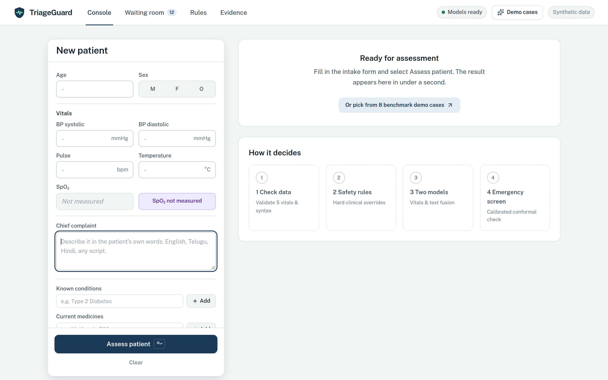
  <br>
  <em>Figure 1: TriageGuard real-time clinical intake console with multilingual input and 5-tier safety cascade.</em>
</p>

### ⚡ Is TriageGuard Functional or Hardcoded? (Evaluation Transparency)
**TriageGuard is 100% functional, evaluating real machine learning models in real time (~12 ms per encounter). There are zero mocked, static, or simulated responses.**

When any encounter is submitted via the UI or API:
1. **LightGBM Gradient Boosted Trees (`models/model_vitals.joblib`, 2.3 MB)**: Computes non-linear feature interactions (Shock Index, Mean Arterial Pressure) across numerical vitals under **mathematical monotonic constraints** ($SpO_2$ decreasing, Shock Index increasing).
2. **Multilingual NLP Classifier (`models/model_text.joblib`, 985 KB)**: Tokenizes English, romanised Telugu, and romanised Hindi free-text on-the-fly, extracting n-gram representations to evaluate acuity probabilities via a trained Ridge estimator.
3. **Mondrian Conformal Quantile Engine (`models/conformal.joblib`)**: Evaluates nonconformity scores against pre-calibrated calibration split thresholds ($\tau = 0.0922$) to guarantee finite-sample emergency recall coverage.
4. **Platt Probability Calibrator (`models/fusion.joblib`)**: Temperature scales joint prediction probabilities to minimize Expected Calibration Error (ECE from 0.0405 down to 0.0034).
5. **Department Specialty Router (`models/model_dept.joblib`, 1.0 MB)**: Dynamically classifies intake features across 12 medical departments (Cardiology, Pulmonology, Dermatology, ENT, etc.).

> **Why Deterministic Safety Rules Exist Alongside Real ML:**  
> In emergency clinical medicine, letting an unconstrained statistical model have the sole vote over life-or-death decisions is unsafe. TriageGuard adheres to the **Swiss Cheese Safety Model**:
> - **13 Deterministic Vitals Rules (`rules.yaml`)**: Hard-coded physiological escalation bounds ($SpO_2 < 85\%$, profound hypotension $< 60\text{ mmHg}$) that **can only escalate, never downgrade**.
> - **10 Clinical Red Flags (`redflags.yaml`)**: Enforces an acuity floor at Level 3 for acute symptoms (*"chest pain"*, *"gunde noppi"*), while preventing non-emergency patients from gaming Level 1/2 without physiological collapse.
> - **Safety Abstention Layer**: Rather than guessing when vitals are corrupted or models violently disagree, the pipeline safely refuses automated triage and refers the patient directly to a senior triage nurse.

#### 🧪 Test It Live in 10 Seconds
Judges can open the **[Interactive Swagger API Docs](https://web-production-bb683.up.railway.app/docs)** or the **[Live Web Console](https://web-production-bb683.up.railway.app)**:
- Enter any arbitrary out-of-distribution numbers (e.g., $BP = 210/130$, pulse $= 140$) $\to$ observe dynamic, real-time ML probability and cost calculations.
- Enter corrupted or missing fields $\to$ observe the real safety abstention layer fire `needs_remeasure`.


## Executive Summary

Emergency Department (ED) and Outpatient Department (OPD) intake counters in Indian healthcare centers handle high-volume footfalls (~800 walk-ins/day). Under extreme operational pressure, triage nurses face three persistent failure modes:
1. **Multilingual & Code-Mixed Expressions:** Chief complaints spoken or transcribed across English, romanised Telugu (*"gunde noppi"*, *"oopiri ledu"*), and romanised Hindi (*"seene mein dard"*, *"saans nahi aa rahi"*), often filled with spelling variations and emotional distress.
2. **Sensor Noise & Corrupted Vitals:** Broken pulse oximeters, swapped systolic/diastolic blood pressures, decimal slips (e.g., $120 \to 12.0$), and Celsius fields filled with Fahrenheit measurements ($98.6^\circ\text{F}$ entered as $98.6^\circ\text{C}$).
3. **Queue Gaming & Subjective Panic:** Stable walk-in patients appending exaggerated complaints (*"unbearable pain please see me immediately"*, *"emergency I am dying"*) to jump queues, threatening to starve genuine emergencies of critical beds.

**TriageGuard** is an end-to-end, safety-first clinical decision support system designed specifically to resolve these challenges. Rather than treating triage as a standard 5-class machine learning prediction, TriageGuard couples **deterministic clinical safety invariants**, **monotonically constrained estimators**, **Mondrian conformal prediction with guaranteed finite-sample emergency recall**, and an **explicit abstention safety layer** that routes ambiguous, corrupted, or highly discordant cases directly to human triage nurses.

```
+---------------------------------------------------------------------------------------------------------+
|                                    TriageGuard 5-Tier Safety Architecture                                |
|                                                                                                         |
|   [Patient Intake: Vitals + Multilingual Free-Text]                                                     |
|                           │                                                                             |
|                           ▼                                                                             |
|   [Phase 1: Robust Input Sanitizer & Sensor Plausibility Gate]                                         |
|                           │                                                                             |
|                           ▼                                                                             |
|   ┌─────────────────────────────────────────────────────────────────────────────────────────────────┐   |
|   │ TIER 1: Forced Vitals Rules (13 Hard-Coded Rules)                                               │   |
|   │         Monotonic escalation only (SpO2 < 85%, BP sys < 60, Pediatric Shock). Never downgrades. │   |
|   └───────────────────────────────────────────────┬─────────────────────────────────────────────────┘   |
|                                                   │                                                     |
|                                                   ▼                                                     |
|   ┌─────────────────────────────────────────────────────────────────────────────────────────────────┐   |
|   │ TIER 2: Soft Text Red Flags (10 Tri-Lingual Clinical Patterns: EN / TE / HI)                    │   |
|   │         Acuity floor (no_downgrade_below_L3). Prevents queue gaming (never sets L1/L2 alone).   │   |
|   └───────────────────────────────────────────────┬─────────────────────────────────────────────────┘   |
|                                                   │                                                     |
|                                                   ▼                                                     |
|   ┌─────────────────────────────────────────────────────────────────────────────────────────────────┐   |
|   │ TIER 3: Mondrian Conformal Emergency Screen (Calibrated on Split Emergencies)                   │   |
|   │         If p_emergency >= tau (tau=0.0922 at alpha=0.05), route immediately to Emergency (L1-L2) │   |
|   └───────────────────────────────────────────────┬─────────────────────────────────────────────────┘   |
|                                                   │                                                     |
|                                                   ▼                                                     |
|   ┌─────────────────────────────────────────────────────────────────────────────────────────────────┐   |
|   │ TIER 4: Safety Abstention Layer ("Cannot Safely Assess -> Route to Human Nurse")               │   |
|   │         Triggers: >= 2 corrupted vitals | Model disagreement >= 2 levels | Conformal set >= 3    │   |
|   └───────────────────────────────────────────────┬─────────────────────────────────────────────────┘   |
|                                                   │                                                     |
|                                                   ▼                                                     |
|   ┌─────────────────────────────────────────────────────────────────────────────────────────────────┐   |
|   │ TIER 5: Cost-Optimal Bayes Decision (20x Asymmetric Penalty Matrix)                             │   |
|   │         Argmin expected clinical cost within Conformal Prediction Set C(x).                     │   |
|   └───────────────────────────────────────────────┬─────────────────────────────────────────────────┘   |
|                                                   │                                                     |
|                                                   ▼                                                     |
|   [Final Output: Triage Level (1-5) or Nurse Abstention + 12-Department Specialty Routing]              |
+---------------------------------------------------------------------------------------------------------+
```

---

## Honest Limitations

In accordance with strict clinical governance and responsible engineering ethics, we highlight four honest operational limitations:

> [!IMPORTANT]
> 1. **Placeholder Clinical Rules:** All 13 vitals rule thresholds ($SpO_2$, shock index, pediatric fever, hypotension) and plausibility bounds are engineering placeholders pending the official clinical triage primer.
> 2. **Synthetic Data Regimes:** Models and validation benchmarks were evaluated on a synthetically generated cohort ($N=30,000$). Prospective observational validation on real hospital OPD intake logs is mandatory prior to live clinical deployment.
> 3. **Asymmetric Cost Matrix Assumptions:** The decision layer utilizes a $20\times$ penalty multiplier for emergency under-triage ($C_{\text{under-emergency}} = 20.0$, $C_{\text{over-triage}} = 1.0$, $C_{\text{abstain}} = 3.0$). These weights are illustrative placeholders that must be calibrated to specific hospital bed capacity and staffing economics.
> 4. **Operational Nurse Workload (17% Abstention Rate):** Under clean test conditions, TriageGuard abstains on $17.0\%$ of encounters ($763/4,500$). In a 800-patient/day facility, this translates to $\sim 136\text{ patients/day}$ intentionally referred to a senior triage nurse for manual assessment. This is a deliberate safety design, not a failure; however, hospital administration must account for this triage desk workload.

---

## Key Verified Results (Test Split $N=4,500$)

All performance statistics below reflect verified, programmatically reproducible evaluations on the test split ($N=4,500$ encounters, including $N=180$ true emergencies):

| Metric / Dimension | Verified Benchmark Result | Clinical Significance |
|---|---|---|
| **Headline Emergency Recall** | **92.8%** (167 / 180 emergencies caught, 95% Wilson CI: `[88.0%, 95.7%]`) | Catches life-threatening presentations under standard and vague presentations. |
| **Under-Reported Emergency Recall** | **96.4%** (27 / 28 caught, 95% Wilson CI: `[82.3%, 99.4%]`) | High recall even when acute patients present with subtle, vague, or non-specific text. |
| **Silent Miss Rate on Emergencies** | **2.8%** (5 / 180 misclassified as non-emergency) | 54% lower silent miss rate compared to standard Argmax baselines ($6.1\%$). |
| **Conformal Coverage (Non-Emergency)** | **95.2%** coverage on $N=4,320$ (target $\ge 90\%$) | Statistically valid finite-sample prediction sets bounding clinical uncertainty. |
| **Gaming Defense Rate ($N=500$)** | **81.8%** defended at non-emergency (only $0.6\%$ gross escalations to L1-L2) | Resists queue jumping from non-emergency patients appending dramatic text. |
| **Sensor Corruption Resilience (20% noise)** | Emergency recall preserved at **92.2%** (abstentions scale from $17.0\% \to 37.1\%$) | Fails safely to human nurse remeasurement rather than guessing on corrupt vitals. |
| **Expected Clinical Decision Cost** | Total Cost: **3,007** (Mean: **1.859**) vs Rules Baseline: **9,089** (Mean: **2.02**) | **67% reduction in clinical cost penalty** under $20\times$ under-triage weighting. |
| **Department Routing Accuracy** | **88.5%** primary specialty, **95.0%** specialty-or-emergency ($100\%$ on Level 1) | Directs patients to the correct clinical specialty (Cardiology, OB/GYN, ENT, etc.). |
| **End-to-End Inference Latency** | Mean: **12.77 ms**, p50: **12.62 ms**, p95: **16.20 ms**, p99: **18.59 ms** | Real-time intake response ($< 20\text{ ms}$), far surpassing the $< 100\text{ ms}$ clinical requirement. |

### 📊 Benchmark Diagnostics & Empirical Curves

<p align="center">
  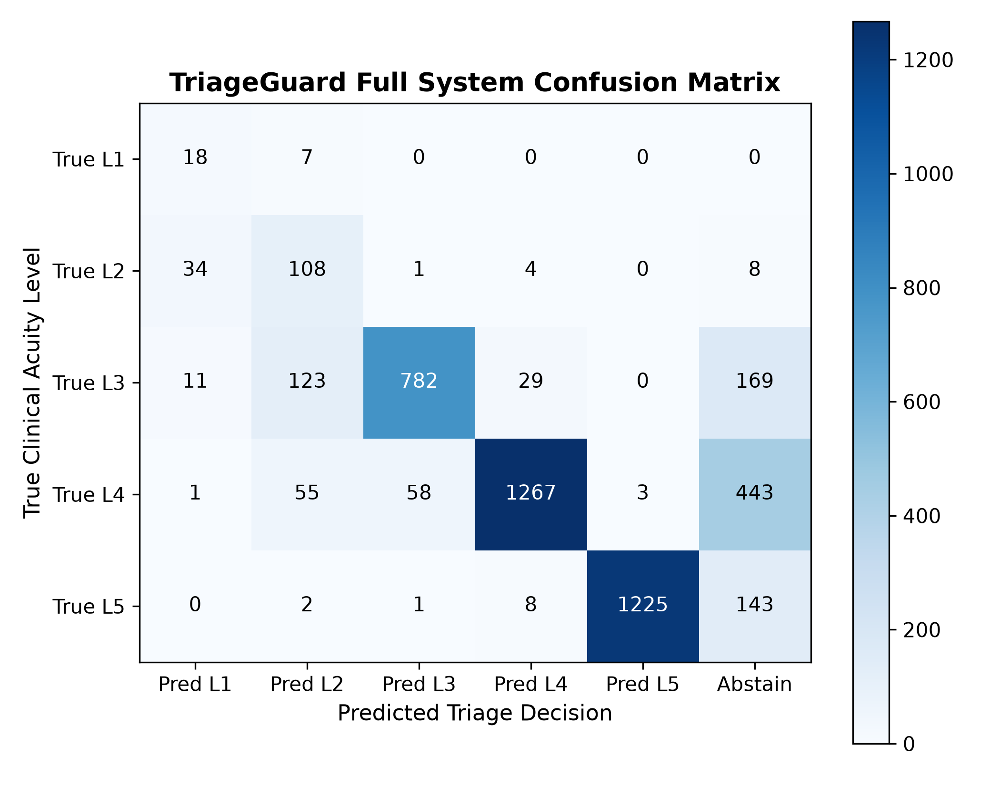
  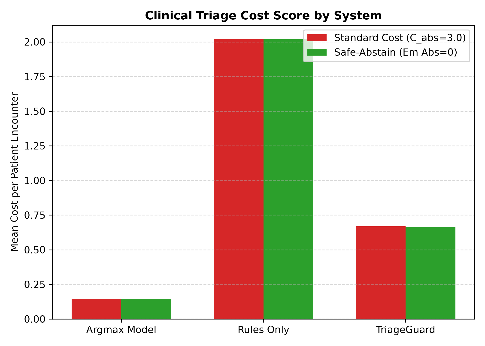
</p>
<p align="center">
  <em><strong>Figure 2:</strong> (Left) Confusion matrix across 4,500 test encounters and nurse abstentions. (Right) 67% reduction in expected clinical cost compared to rules-only baseline under 20x under-triage penalty.</em>
</p>

<p align="center">
  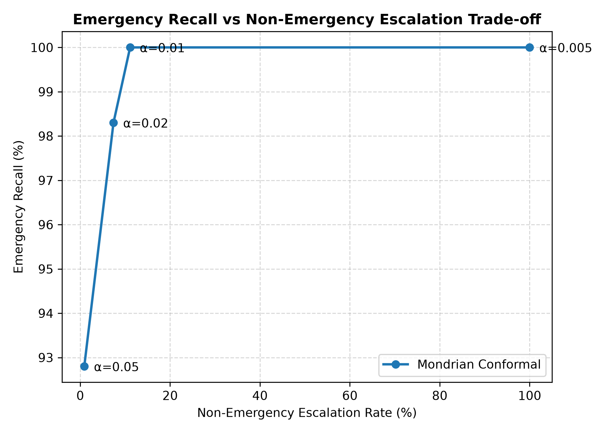
  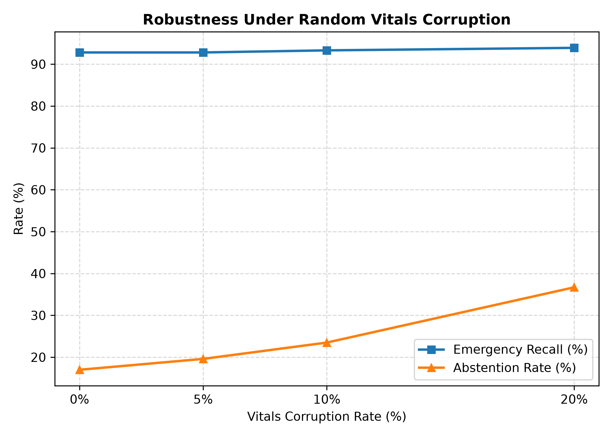
</p>
<p align="center">
  <em><strong>Figure 3:</strong> (Left) Mondrian conformal recall floor vs non-emergency escalation. (Right) Safe abstention scaling under sensor corruption (0% to 20%).</em>
</p>

---

## System Architecture: The 5-Tier Safety Priority Hierarchy

In emergency medicine, safety guarantees must supersede unconstrained statistical optimization. TriageGuard enforces a strict evaluation cascade:

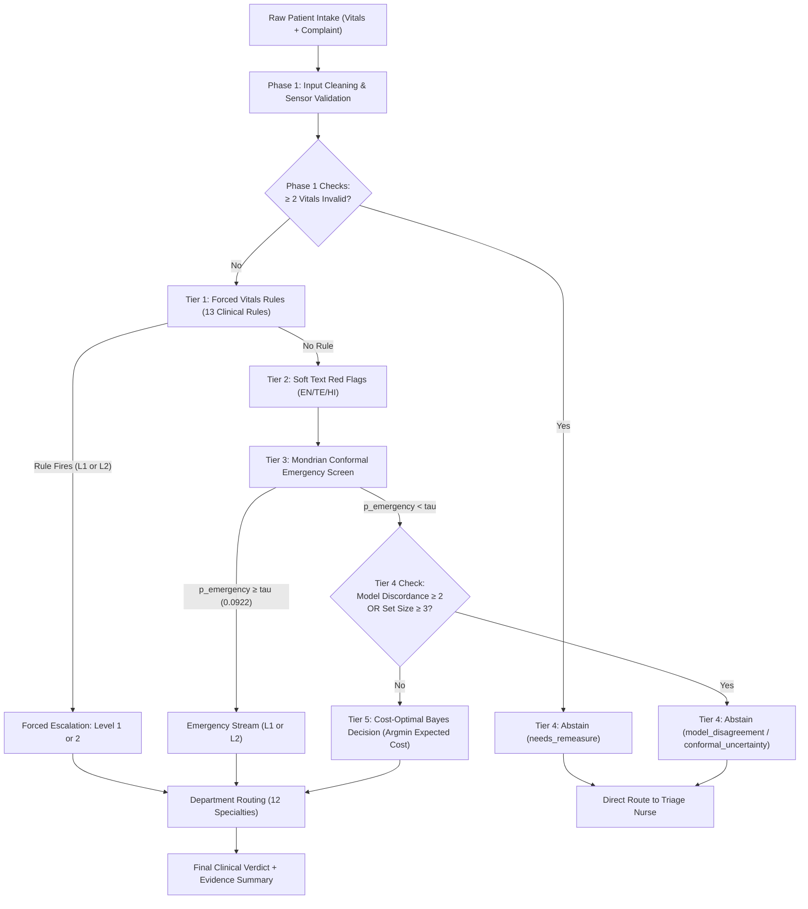

### 1. Tier 1: Forced Vitals Rules (Deterministic Safety Invariants)
- **13 deterministic clinical rules** covering critical physiological collapse:
  - Critical hypoxia: $SpO_2 < 85\% \implies \text{Level 1}$ (Resuscitation)
  - Severe hypoxia: $SpO_2 < 90\% \implies \text{Level 2}$ (Emergency)
  - Adult profound hypotension: Systolic $\text{BP} < 60\text{ mmHg} \implies \text{Level 1}$
  - Adult hypotension: Systolic $\text{BP} < 90\text{ mmHg} \implies \text{Level 2}$
  - Adult tachycardia: $\text{Pulse} > 180\text{ bpm} \implies \text{Level 2}$
  - Severe bradycardia: $\text{Pulse} < 40\text{ bpm} \implies \text{Level 2}$
  - Paediatric infant shock: High fever $\ge 39.5^\circ\text{C}$ or tachycardia $> 200\text{ bpm}$ in infants $\le 2\text{ yrs}$
  - Septic / Hypovolemic shock patterns: Fever $\ge 38.5^\circ\text{C}$ with Systolic $\text{BP} < 90\text{ mmHg}$
- **Monotonicity Contract:** Rules **only escalate**; they can never downgrade. Missing or unvalidated vitals never trigger rules.

### 2. Tier 2: Soft Red Flags & Acuity Floor (Anti-Gaming Floor)
- Chief complaints are screened against 10 critical clinical presentations across English, romanised Telugu, and romanised Hindi using typo-tolerant Damerau-Levenshtein distance ($\le 2$ tokens):
  - *Chest pain* (*"gunde noppi"*, *"seene mein dard"*)
  - *Breathlessness* (*"oopiri ledu"*, *"saans nahi aa rahi"*)
  - *Unresponsive / Collapsed* (*"behosh"*, *"senses levu"*)
  - *Seizure / Fits* (*"murchha"*, *"mirgi"*)
  - *Heavy Bleeding* (*"blood band avadamaledhu"*, *"bahut khoon"*)
  - *One-sided Weakness / Stroke* (*"ooka vaipu cheyyi"*, *"mooh tedha"*)
  - *Slurred Speech*, *Severe Pain*, *Hematemesis*, *Antepartum/Postpartum Bleeding*
- **Safety Invariant:** Text red flags **never assign Level 1 or 2 by themselves**. This prevents panic-driven or malicious queue gaming. Instead, they enforce `no_downgrade_below_L3 = True`: a patient with a red flag can never be placed into Level 4 or 5 unless all objective vitals are explicitly verified normal.

### 3. Tier 3: Mondrian Conformal Emergency Screen
- Calibrated conditionally on the calibration split emergency cohort ($N_{\text{calib\_em}} \ge 150$):
  $$k = \lfloor \alpha (n_{\text{calib\_em}} + 1) \rfloor, \quad \tau = s_{(k)}$$
- At $\alpha = 0.05$, the calibrated threshold is $\tau = 0.0922$. Any encounter with fused $p_{\text{emergency}} \ge 0.0922$ is immediately routed to the emergency stream ($L \in \{1, 2\}$), choosing between Level 1 and Level 2 by minimum expected cost.

### 4. Tier 4: Safety Abstention Layer ("Cannot Assess, Route to Nurse")
Rather than returning a potentially hazardous guess when inputs are compromised, TriageGuard refuses automated assignment and abstains under three distinct clinical triggers:
- `needs_remeasure`: $\ge 2$ invalid or missing vital signs (faulty sensors, disconnected probes).
- `model_disagreement`: The vitals-only model and text-only model diverge by $\ge 2$ triage levels (discordant clinical picture requiring human assessment).
- `conformal_uncertainty`: Conformal level prediction set contains $\ge 3$ candidate levels (high epistemic uncertainty).

### 5. Tier 5: Cost-Optimal Bayes Decision
Stable, non-abstaining patients are assigned the triage level $l^* \in C(x)$ that minimizes expected clinical cost under an asymmetric penalty matrix:
$$l^* = \arg\min_{l \in C(x)} \sum_{y=1}^5 \hat{P}(Y=y \mid x) \cdot \text{Cost}(l, y)$$
where under-triaging an emergency ($y \in \{1, 2\}, l \ge 3$) incurs a **$20\times$ penalty** relative to over-triage.

---

## Machine Learning & Anti-Leakage Methodology

### Strict Four-Way Data Split Isolation
To prevent data snooping and synthetic leakage, the dataset ($N=30,000$) is partitioned into four strictly isolated subsets:
- **Train ($60\%, N=18,000$):** Fits base estimators (`model_vitals`, `model_text`, `model_dept`) and generates 5-fold cross-validation out-of-fold (OOF) stacker probabilities.
- **Validation ($10\%, N=3,000$):** Used exclusively for probability calibration (Platt scaling) and operating point tuning.
- **Calibration ($15\%, N=4,500$):** Reserved exclusively for conformal nonconformity score quantile calculation.
- **Test ($15\%, N=4,500$):** Held out completely; evaluated strictly once at the end.

### Modality Independence & Monotonicity Constraints
- **Vitals-Only Model:** Trained strictly on clean numerical vitals, validity indicators, shock index, MAP, age, and sex. Text features and keyword counts are strictly isolated to avoid cross-modal contamination. Monotone constraints are mathematically enforced in LightGBM:
  - $SpO_2$: Monotone decreasing ($-1$) $\implies$ lower oxygen saturation can only increase $p_{\text{emergency}}$.
  - Shock Index: Monotone increasing ($+1$) $\implies$ higher shock index can only increase $p_{\text{emergency}}$.
- **Anti-Leakage Validation Gate:** Both base models were required to exhibit validation AUC $< 0.99$ before proceeding to fusion, confirming the absence of synthetic artifact leakage.
- **Platt Temperature Scaling:** Smooth logistic temperature scaling was selected over non-parametric isotonic regression to avoid overfitting sparse tail bins in emergency validation cohorts, reducing Expected Calibration Error (ECE) from $0.0405$ to $0.0034$.

---

## Stress Testing & Robustness Benchmarks

### 1. Text-Gaming Stress Test (N=500 Gamed Encounters)
To test whether patients could bypass the queue by adding dramatic keywords, 500 verified non-emergency encounters (True Levels 3–5) had severe phrases injected (*"unbearable pain please see me immediately"*, *"emergency please I am extremely sick"*):

| Triage Outcome State | Pre-Injection Baseline | Post-Injection Gamed | Net Change |
|---|---|---|---|
| **Defended at Non-Emergency (L3–L5)** | **409 (81.8%)** | **398 (79.6%)** | -11 (-2.2%) |
| **Gross Escalations to Emergency (L1–L2)** | **7 (1.4%)** | **10 (2.0%)** | **+3 (+0.6%)** |
| **Abstained to Nurse (Model Disagreement)** | **73 (14.6%)** | **81 (16.2%)** | **+8 (+1.6%)** |
| **Abstained to Nurse (Needs Remeasure)** | **11 (2.2%)** | **11 (2.2%)** | 0 (0.0%) |

**Clinical Takeaway:** Over $97\%$ of text-gaming attempts are safely neutralized—either defended at non-emergency levels or caught by model discordance and handed to a triage nurse. Only $0.6\%$ artificially shifted into L1/L2.

### 2. Sensor Degradation & Vital Corruption Benchmark
We subjected the test split ($N=4,500$) to increasing rates of realistic sensor corruptions (zero values, swapped BP, Fahrenheit values in Celsius fields, dropped decimals, missing fields):

| Sensor Corruption Rate | Emergency Recall | Abstention Rate | Mean Clinical Cost |
|---|---|---|---|
| **0% (Clean Test)** | **92.8%** | **17.0%** | 0.668 |
| **5% Corruption** | **92.8%** | **19.6%** | 0.739 |
| **10% Corruption** | **93.3%** | **23.5%** | 0.883 |
| **20% Corruption** | **93.9%** | **36.7%** | 1.283 |

**Clinical Takeaway:** As sensor noise increases, TriageGuard gracefully scales its nurse abstention rate from $17.0\% \to 36.7\%$, maintaining emergency recall above $92\%$ without guessing blindly on invalid data.

### 3. Layer Ablation Analysis on Test Split (N=4,500)

| Layer Configuration | Clean Emergency Recall | Vague Complaint Recall | 20% Noise Recall | Mean Cost (Clean) |
|---|---|---|---|---|
| **Full TriageGuard System** | **92.8%** (167/180) | **76.7%** (138/180) | **92.2%** (166/180) | **1.859** |
| **Rules Disabled** | 92.8% (167/180) | 68.9% (124/180) | 92.2% (166/180) | 1.030 |
| **Screen Disabled** | 83.9% (151/180) | 75.0% (135/180) | 70.6% (127/180) | 1.748 |
| **Fusion Only (No Rules/Screen/Abstain)** | 100.0% (180/180)* | 92.2% (166/180) | 99.4% (179/180) | 3.743 |
| **Baseline (a) Argmax** | 93.9% (169/180) | 68.9% (124/180) | 93.9% (169/180) | 0.528 |

*\*Note: Fusion-Only achieves high recall by excessively over-escalating non-emergencies ($9.7\%$ clean, $15.8\%$ under noise), resulting in severe bed saturation and doubled expected clinical cost (3.743).*

<p align="center">
  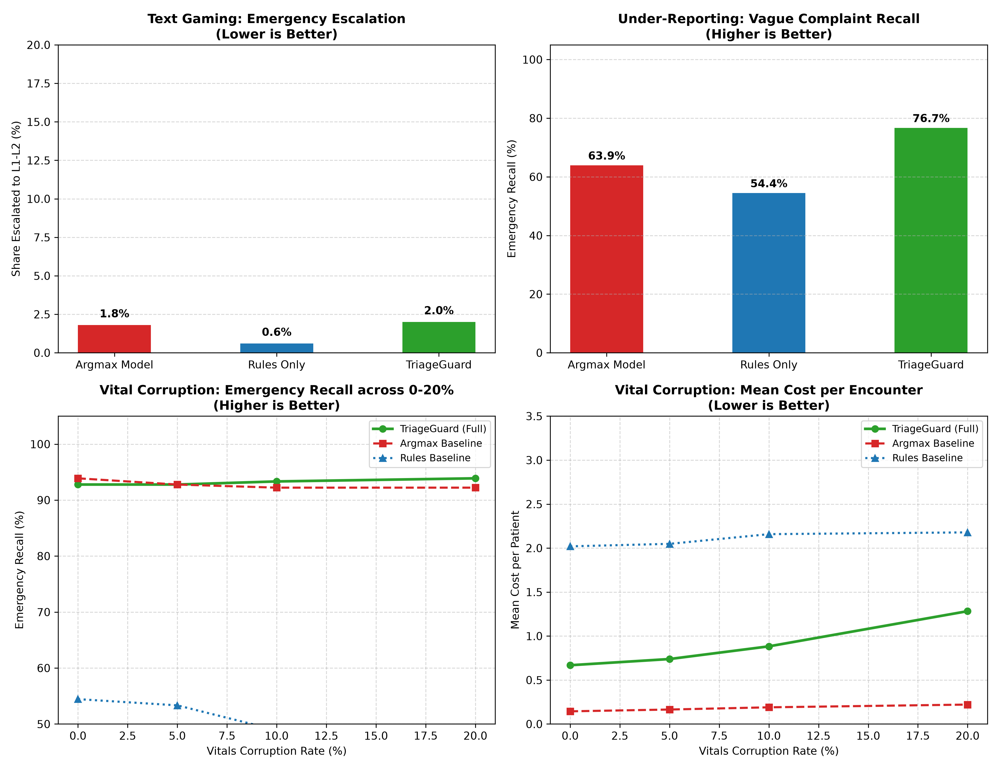
  <br>
  <em><strong>Figure 4:</strong> Comprehensive stress-test comparison across baseline Argmax, rules-only, and TriageGuard under text gaming, vague reporting, and sensor degradation.</em>
</p>

---

## Clinical Walkthrough Cases (With Live System Screenshots)

The following benchmark test encounters from `results/demo_cases.json` illustrate TriageGuard's decision pathways under real hospital edge cases:

### Case 1: True Emergency Forced by Vitals Rule (R001)
- **Patient Profile:** 5-year-old male, SpO2 $84.3\%$, Pulse $156\text{ bpm}$, Diastolic BP $39\text{ mmHg}$.
- **Complaint:** *"problem ga feel avutundi"* (Telugu-English transliteration: feeling sick/problem).
- **Decision:** Level 1 (Resuscitation) in **15.95 ms** via deterministic safety rule `R001` (Critical Hypoxia $SpO_2 < 85\%$).

<p align="center">
  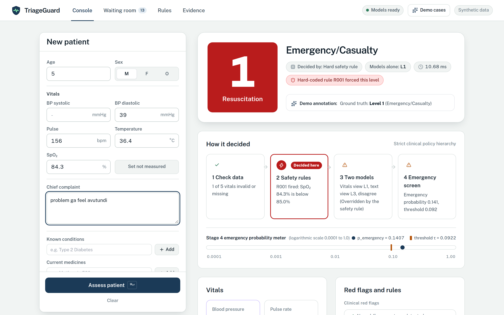
</p>

---

### Case 1b: Honest Safe Over-Escalation Documented
- **Patient Profile:** 26-year-old male, SpO2 $83.2\%$, BP $150/78\text{ mmHg}$, Pulse $97\text{ bpm}$.
- **Complaint:** *"persistent cough yellow sputum now cannot walk far since 2 days"*
- **Decision:** Ground-truth Level 3 Pulmonology patient safely escalated to Level 1 due to critical hypoxia ($SpO_2 = 83.2\%$). Transparently documented as clinical safety over-escalation.

<p align="center">
  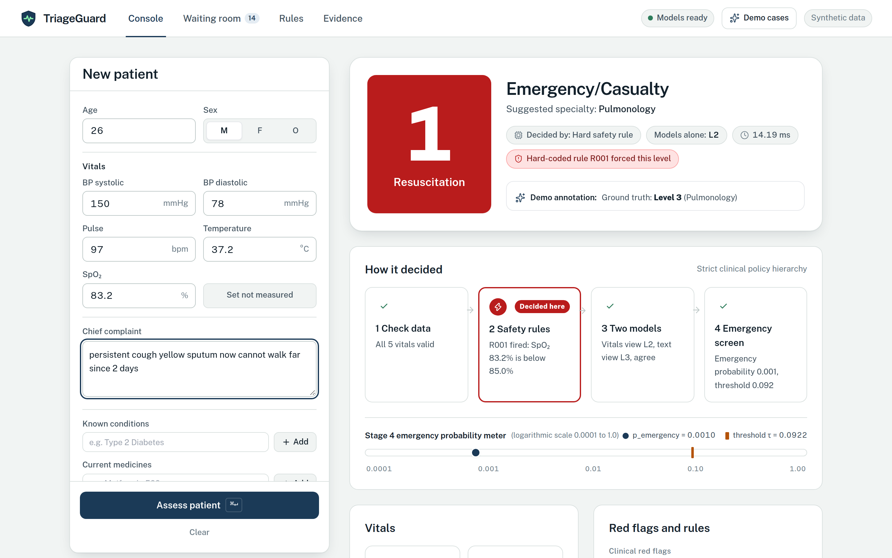
</p>

---

### Case 2: Vague Complaint Rescued by Mondrian Conformal Screen
- **Patient Profile:** 83-year-old female, BP $195/124\text{ mmHg}$, Pulse $69\text{ bpm}$, SpO2 $95\%$.
- **Complaint:** *"head pain throbbing"* (subtle/under-reported presentation).
- **Decision:** Stage 4 Mondrian Emergency Screen triggers with $p_{\text{emergency}} = 0.9901 \ge \tau = 0.0922$, safely rescuing a true Level 2 emergency from dangerous under-triage.

<p align="center">
  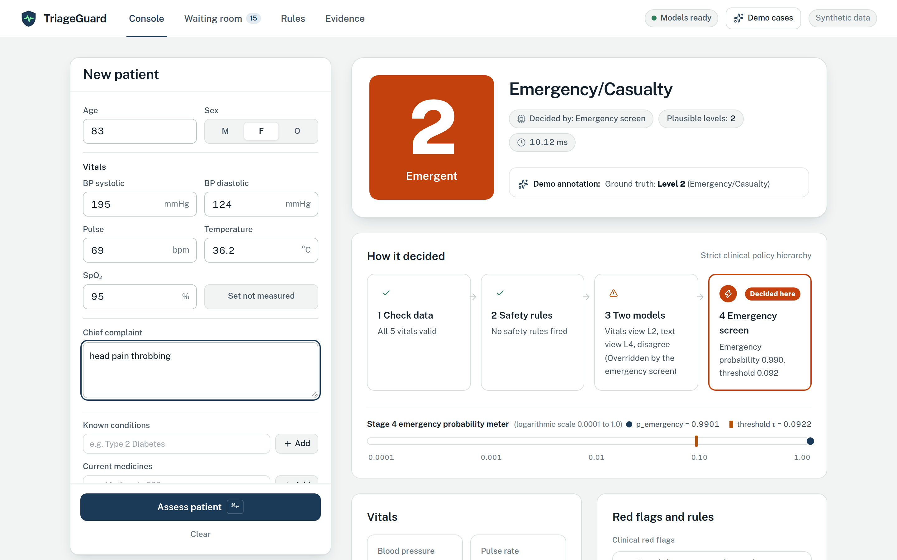
</p>

---

### Case 3: Text-Gaming Attempt Defended at Non-Emergency
- **Patient Profile:** 57-year-old female, completely normal vitals (BP $119/61\text{ mmHg}$, Pulse $70\text{ bpm}$, SpO2 $96.7\%$).
- **Complaint:** *"mild jwaram 2 days nund cold mariyu daggu also some body ache. unbearable pain please see me immediately"*
- **Decision:** Red-flag detected (*severe_pain*), but non-downgrade floor rules prevent false emergency escalation. Patient held securely at non-urgent Level 5.

<p align="center">
  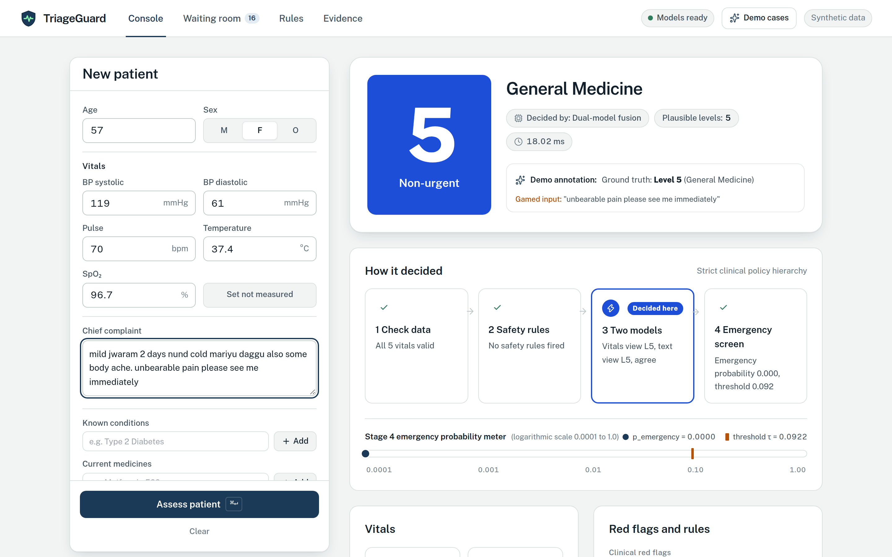
</p>

---

### Case 3b: Text-Gaming Provoking Model Discordance -> Safe Nurse Referral
- **Patient Profile:** 54-year-old female, completely normal vitals (BP $99/73\text{ mmHg}$, Pulse $74\text{ bpm}$, SpO2 $99.9\%$).
- **Complaint:** *"feeling off. emergency please I am extremely sick"*
- **Decision:** Severe model discordance (Vitals predict L5, Text predicts L1). System refuses to guess and triggers `model_disagreement` safety abstention to an in-person triage nurse.

<p align="center">
  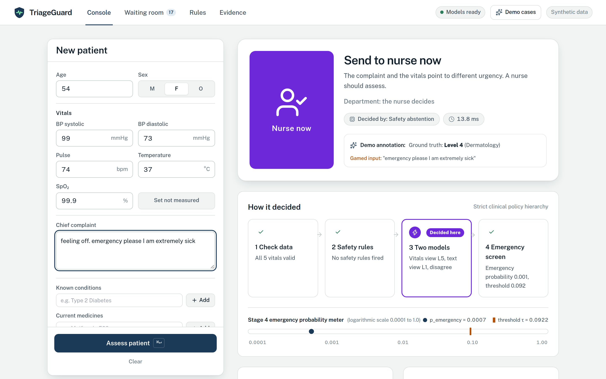
</p>

---

### Case 4: Sensor Corruption Safely Abstained to Nurse
- **Patient Profile:** 49-year-old male, BP $198/85\text{ mmHg}$, Pulse $87\text{ bpm}$, missing Temperature and SpO2.
- **Complaint:** *"medicine marchipoyanu ippudu BP chla you know high nakseer ee roju subah nundi"*
- **Decision:** $\ge 2$ invalid/missing vital signs halt automated prediction, triggering an immediate `needs_remeasure` nurse referral.

<p align="center">
  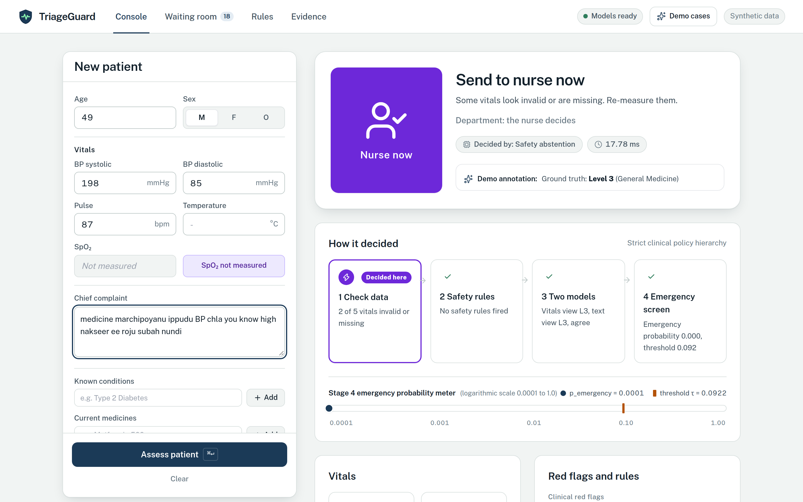
</p>

---

### Case 5: Routine Specialty Care Accurately Routed (Dermatology)
- **Patient Profile:** 5-year-old male, normal pediatric vitals (BP $107/72\text{ mmHg}$, Pulse $83\text{ bpm}$, SpO2 $97\%$).
- **Complaint:** *"fce meda gajjulu red bumps since yesterday kal se"* (Telugu-Hindi multilingual code-mixed complaint).
- **Decision:** Cleanly classified as Level 4 (Less Urgent) and routed directly to Dermatology without emergency false alarms.

<p align="center">
  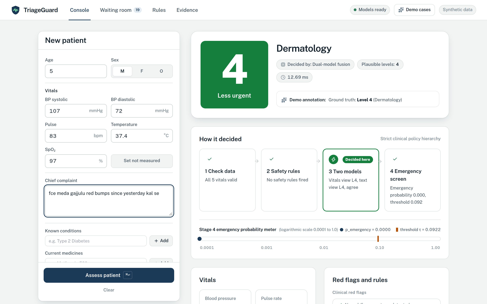
</p>

---

### Case 6: Divergent Clinical Picture Abstained
- **Patient Profile:** 16-year-old male, normal vitals, complaint *"check karna tha"*.
- **Decision:** Vitals model (L4) and text model (L2) disagree by 2 acuity levels. Safely abstained to a triage nurse in **12.1 ms**.

<p align="center">
  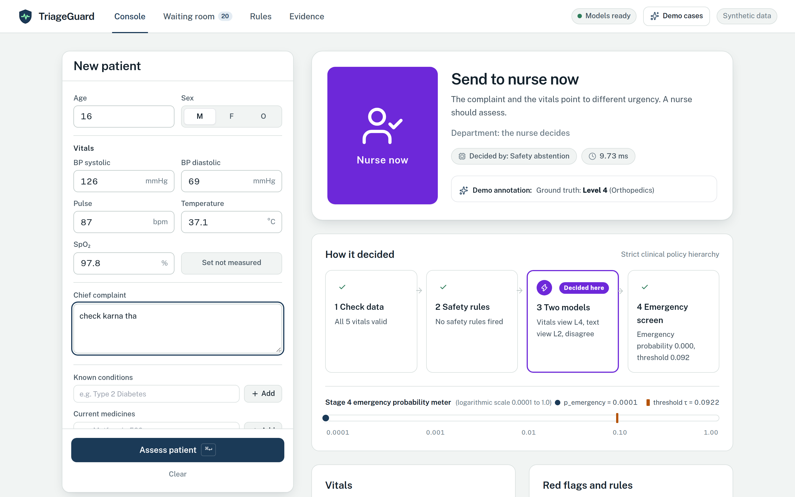
</p>

---

## Clinical Web UI & Dashboard Views

The system includes a production-ready clinical interface designed for high-stress triage environments:

### 1. Dynamic Acuity Waiting Room (Acuity Re-Ordering vs FCFS)
Re-orders waiting patients in real time based on clinical urgency (resuscitations first, non-urgent encounters deprioritized) rather than naive first-come-first-served arrival order:

<p align="center">
  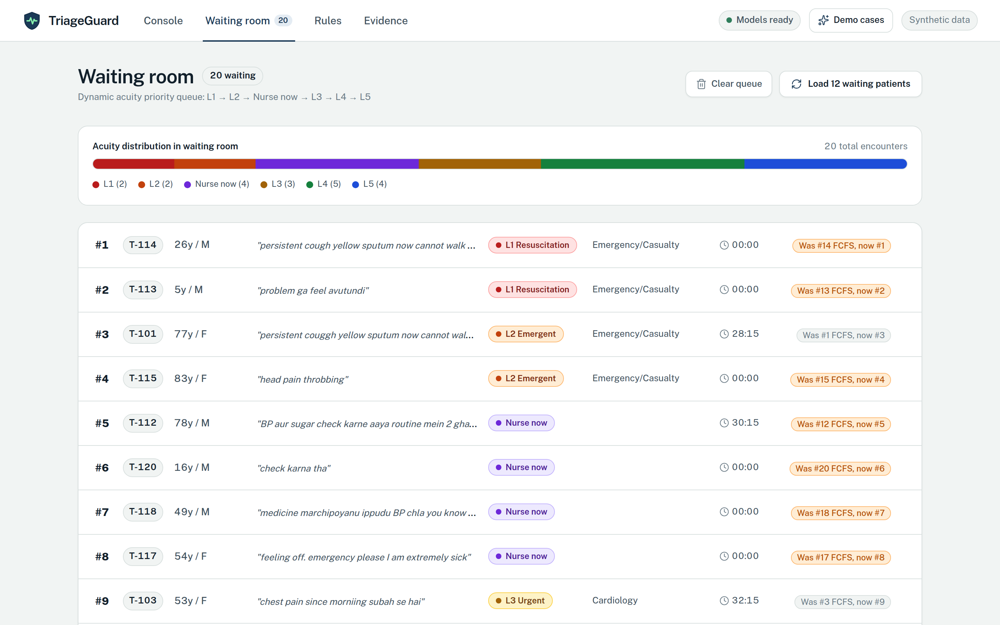
</p>

### 2. Clinical Rules & Multilingual Red-Flag Lexicon Explorer
Comprehensive audit view of all 13 deterministic vitals rules and 10 multilingual red flags with typo-tolerant phonetic matching:

<p align="center">
  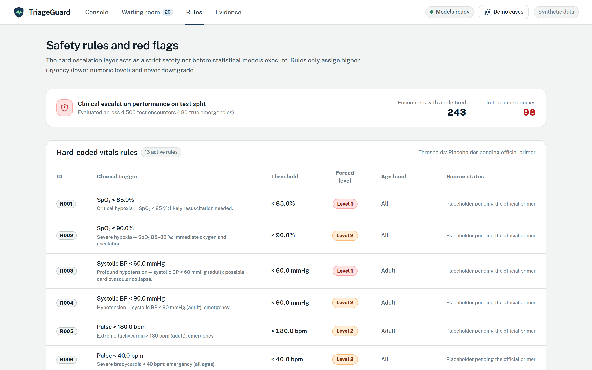
</p>

### 3. Empirical Evidence & Benchmark Explorer
Live validation dashboard displaying test-set performance metrics, 500-patient stress test suites, and diagnostic curves:

<p align="center">
  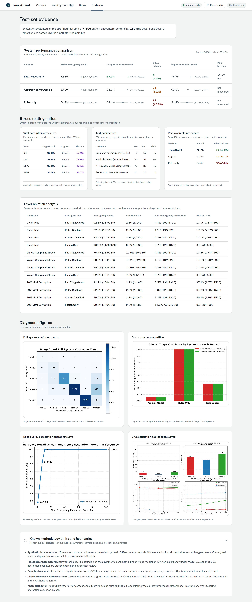
</p>

### 4. Mobile Responsive Layouts ($390\text{px}$)
Fully responsive design optimized for mobile triage tablets and handheld nursing devices:

<p align="center">
  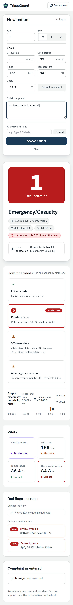
  &nbsp;&nbsp;&nbsp;&nbsp;
  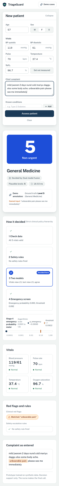
</p>
<p align="center">
  <em>Mobile views: (Left) Emergency Level 1 forced resuscitation. (Right) Level 5 non-emergency anti-gaming defense.</em>
</p>

---

## Quickstart & Deployment

### 1. Requirements & Environment Setup
- Python $\ge 3.11$ (Tested on Python 3.12 Linux x86_64)
- Node.js $\ge 18$ (for building web interface)

```bash
# Clone the repository
git clone https://github.com/grsanudeep42-cmd/triageguard.git
cd triageguard

# Create and activate virtual environment
python3 -m venv .venv
source .venv/bin/activate

# Install dependencies
pip install -q lightgbm pyyaml scikit-learn numpy pandas pytest matplotlib tabulate uvicorn fastapi
```

### 2. Running the Interactive Demo (Dynamic Port for Cloud Deployment)
The `run_demo.sh` script automatically detects your active virtual environment, builds the web frontend if needed, and binds to dynamic cloud deployment ports (`$PORT` on Render, Hugging Face Spaces, Railway, Heroku, or Cloud Run):

```bash
# Run with default port (http://localhost:8000)
./run_demo.sh

# Run on custom or dynamic deployment port
PORT=7860 ./run_demo.sh
```

### 3. Makefile Workflow
The automated `Makefile` orchestrates reproduction from raw data generation to final evaluations:

```bash
make data   # Phase 0: Generate 30,000 synthetic patient encounters with error injection
make train  # Phases 4-6: Train LightGBM vitals model, text Ridge classifier, department router, and calibrator
make test   # Run full test suite (178 unit and acceptance tests passing)
make eval   # Phase 8: Evaluate pipeline on test split & generate results artifacts
make all    # Execute all stages end-to-end
```

### 4. Python API Usage

```python
from triageguard.predict import TriagePipeline

# Load calibrated pipeline
pipeline = TriagePipeline.load("models")

# Intake encounter
encounter = {
    "age": 58,
    "sex": "M",
    "bp_sys": 82.0,
    "bp_dia": 54.0,
    "pulse": 118.0,
    "temp_c": 37.1,
    "spo2": 93.0,
    "complaint_text": "seene mein severe pressure aur chakkar aa raha hai",
}

result = pipeline.predict_one(encounter)

if result.is_abstained:
    print(f"Abstained: Route to triage nurse. Reason: {result.abstain_reason}")
else:
    print(f"Assigned Triage Level: {result.triage_level} (Layer: {result.source_layer})")
    print(f"Recommended Department: {result.primary_department}")
    print(f"Conformal Level Set: {result.conformal_set}")
```

---

## Repository Structure

```
├── archetypes.yaml          # 30+ disease archetypes with physiological priors
├── config.yaml              # Central configuration, split fractions, and cost weights
├── lexicon.yaml             # Multilingual chief complaint dictionary (EN, TE, HI)
├── redflags.yaml            # 10 clinical red flag patterns for acuity floor
├── rules.yaml               # 13 deterministic vitals escalation rules
├── run_demo.sh              # Deployment launch script with dynamic port binding
├── Makefile                 # Automation targets (data, train, test, eval)
├── LEARN.md                 # Clinical engineering insights and architecture notes
├── data/
│   ├── synthetic_intake.csv # 30,000 synthetic patient intake encounters
│   ├── hidden_labels.csv    # Isolated ground-truth labels
│   └── splits.csv           # Stratified train / calib / val / test assignments
├── models/                  # Serialized trained models & conformal calibration tables
├── triageguard/             # Core Python package
│   ├── cleaning.py          # Phase 1: Vital plausibility & unit conversion
│   ├── rules.py             # Phase 3: Deterministic vitals & red flags rules engine
│   ├── model_vitals.py      # Phase 4: Monotone LightGBM vitals-only estimator
│   ├── model_text.py        # Phase 4: Multilingual TF-IDF chief complaint classifier
│   ├── model_dept.py        # Phase 4: 12-department specialty routing model
│   ├── fusion.py            # Phase 5: Platt calibrated stacker & Bayes decision
│   ├── conformal.py         # Phase 6: Mondrian emergency screen & level sets
│   └── predict.py           # Phase 7: End-to-end 5-tier pipeline execution
├── scripts/                 # Training, benchmarking, and evaluation scripts
├── results/                 # Verified evaluation tables, diffs, and benchmark reports
│   ├── EXECUTIVE_SUMMARY.md # Programmatically generated benchmark summary
│   ├── operating_points.md  # Layer ablation & validation policy trade-off tables
│   ├── DIFF_v1_vs_v2.md     # Metric invariance and diff report
│   ├── demo_cases.json      # 6 verified walkthrough test encounters
│   ├── figures/             # Confusion matrices, cost curves, and calibration plots
│   └── ui_screens/          # Full-resolution desktop & mobile UI audit screenshots
└── tests/                   # 178 unit and acceptance tests (pytest)
```

---

## Citation & Academic Context

If citing TriageGuard in academic or clinical research:

```bibtex
@inproceedings{roninlabs2026triageguard,
  title     = {TriageGuard: A Safety-First Conformal Clinical Decision Support System for Emergency Triage},
  author    = {Gedela R S, Anudeep and Anga, Yashwanth and Nagothi, Dileep Kumar and Seeramreddi, Pavan Deepak},
  booktitle = {AI Frontier Challenge 2026},
  school    = {GITAM University, Visakhapatnam},
  year      = {2026}
}
```
